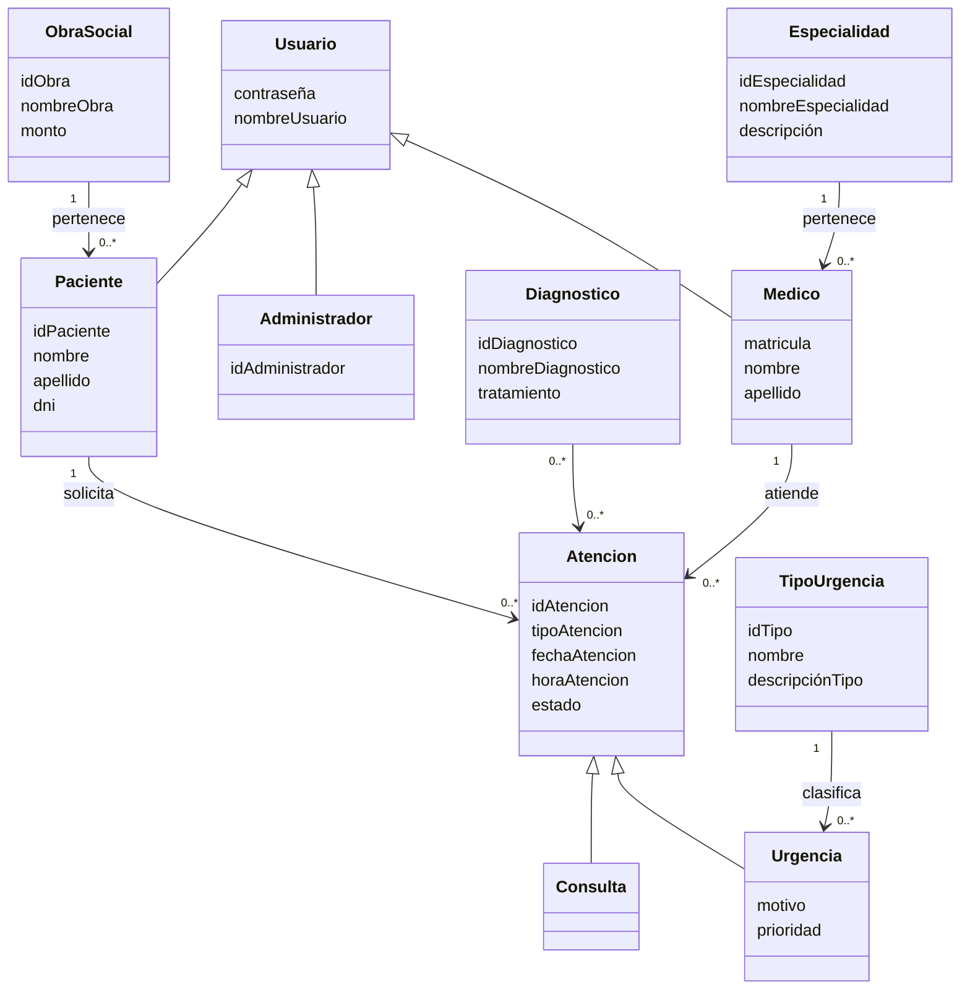

# Propuesta TP-DSW-303

## Grupo
### Integrantes
* Garcia, Miqueas Cristián - 55033
* Paulucci, Gino - 53670
* Zapata, Mayra Belén - 42969

## Tema
### Descripción
El sistema propuesto es una aplicación web destinada a la gestión de turnos médicos y urgencias para un centro de salud. Permite administrar las atenciones entre pacientes y médicos, facilitando la asignación de turnos según disponibilidad. La aplicación contempla distintos tipos de usuarios: los administradores registran a los medicos, visualizan el historial clinico del paciente y verifican los turnos vencidos (no asistidos), los pacientes pueden solicitar turnos y los profesionales acceden a la gestión y visualización de sus turnos y pacientes asignados. Además, permite clasificar las atenciones en consultas (las realizadas por turno) o en una urgencia que deba ser registrada por el administrador.

### Algunos links
* [Sistema en linea](https://tp-dsw-garcia-paulucci-zapata.onrender.com)
* [Video de funcionamiento](https://drive.google.com/file/d/1Sn8mysvs3T-qEsKqygFwAwCeOERsGKT1/view?usp=sharing)

### Notas para la instalación y ejecución
* El codigo fuente del sistema se encuentra en TP-codigo.
* En TP-codigo/backend/database existe un archivo sql para datos precargados y cuales son los usuarios. Crear una base de datos MySQL e importar el archivo SQL proporcionado.
* Crear un archivo .env.development en TP-codigo/backend con los datos que correspondientes (seguir estructura de .env.example).
* Instalar las dependencias del proyecto ejecutando "pnpm install" tanto en TP-codigo/frontend como en TP-codigo/backend.
* Ejecutar el comando "pnpm hash-passwords" en backend para hasear las contraseñas en la BD (el sql se encuentra en texto plano). 
* Ejecutar "pnpm build" tanto en la carpeta de frontend como backend para compilar.
* Ejecutar "pnpm start" en backend para iniciar el sistema. Se abrirán tanto swagger como el localhost
* Ante conflicto de autoapertura, La aplicación estará disponible en http://localhost:3000 (o el puerto configurado), y Swagger en http://localhost:3000/api/docs.

### Tecnologías utilizadas

**Desarrollo del sistema**
- **Frontend:** React 19, Vite 8, React Router DOM 7 y TanStack Query 5.
- **Backend:** Node.js 24, TypeScript y Express 5.
- **Base de datos:** MySQL 8.4.
- **ORM:** MikroORM 6.
- **Driver de conexión:** mysql2.
- **Autenticación:** JWT (jsonwebtoken) y bcryptjs.
- **Documentación de API:** Swagger.
- **Manejo de cookies:** cookie-parser.

**Testing y calidad del código**
- **Vitest:** tests unitarios del frontend.
- **React Testing Library:** tests de componentes React.
- **jest-dom:** validaciones adicionales del DOM.
- **jsdom:** simulación del navegador para tests unitarios.
- **Cypress:** test end-to-end (E2E).
- **Node.js Test Runner y Assert:** tests automatizados del backend.
- **Supertest:** test de integración de la API.
- **ESLint:** análisis estático y control de calidad del código.

### Modelo de Dominio

## Alcance Funcional 

### Alcance Mínimo
Regularidad:
|Req|Detalle|
|:-|:-|
|CRUD simple|1. CRUD  Paciente 2. CRUD Diagnostico 3. CRUD Especialidad|
|CRUD dependiente|1. CRUD Urgencia {depende de} CRUD TipoUrgencia 2. CRUD Medico {depende de} CRUD Especialidad|
| Listado + detalle | 1. Listado de turnos filtrado por fecha y/o médico → detalle muestra información completa del turno, paciente y médico 2. Listado de pacientes → detalle muestra datos del paciente y sus turnos |
| CUU/Epic  | 1. Reservar turno médico de consulta  2. Cancelar turno |

Adicionales para Aprobación
|Req|Detalle|
|:-|:-|
| CRUD     | 1. CRUD TipoUrgencia 2. CRUD ObraSocial 3. CRUD Usuario |
| CUU/Epic | 1. Verificar los estados de turnos por fechas 2. Consultar turnos del medico 3. Consulta de historial clínico del paciente (visualización de atenciones previas) 4. Registrar urgencia |

